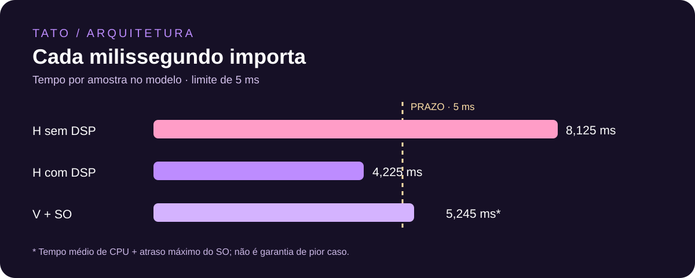
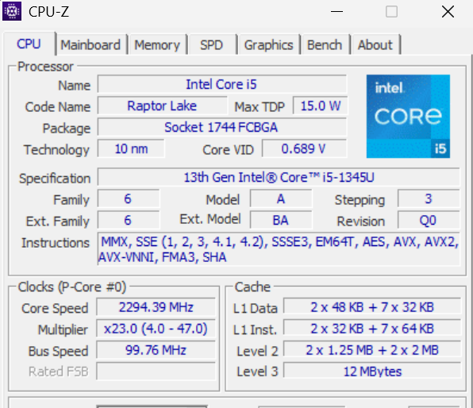
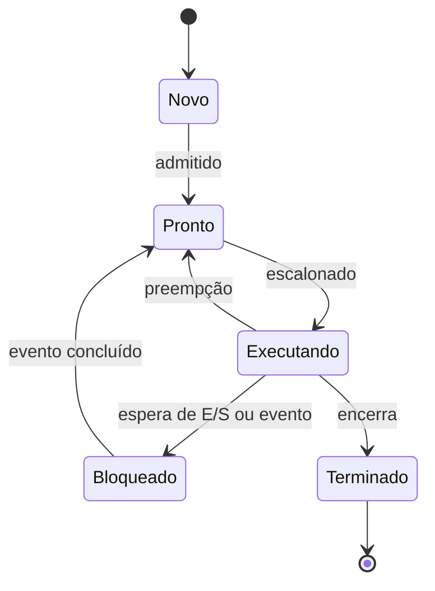
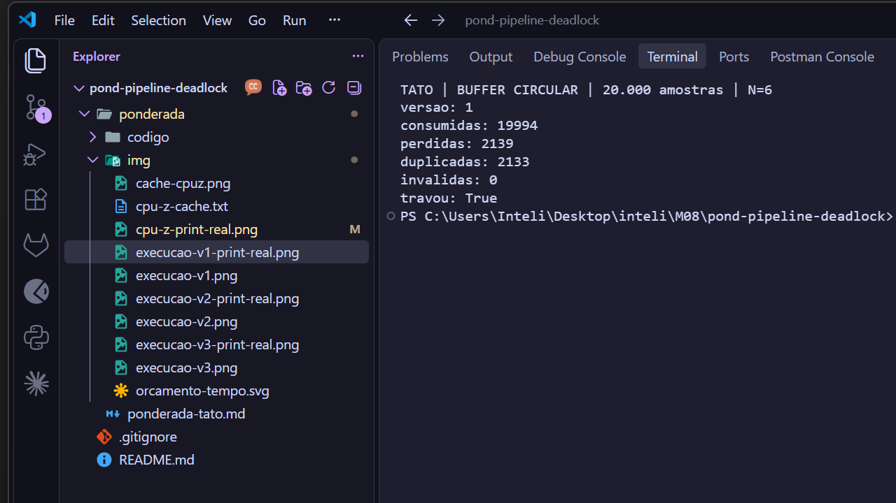
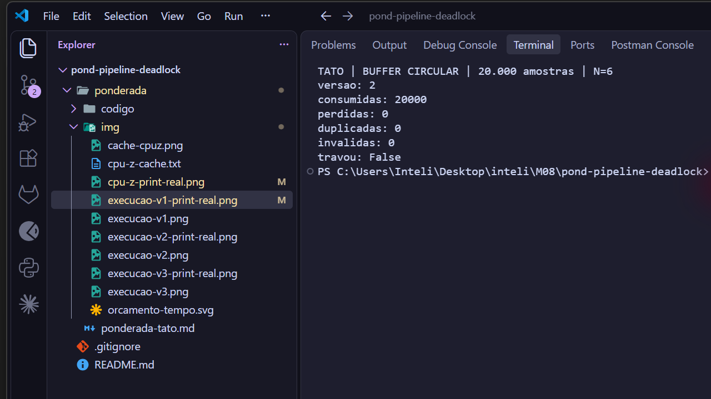
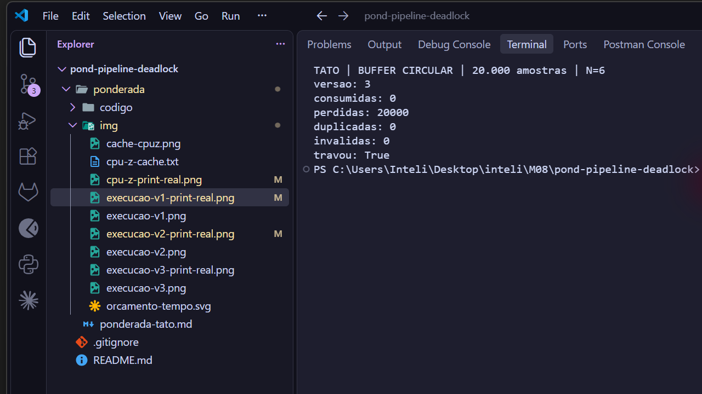
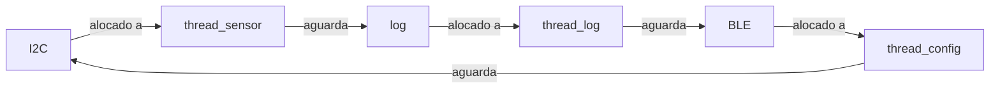

Rayssa Guedes França | D1 = 6 | D2 = 8 | N = 6

# TATO · Do pipeline ao deadlock

> **Uma amostra a cada 10 ms. Uma resposta em até 5 ms.** O caminho até a vibração é crítico; BLE e logs não podem bloqueá-lo.

**Parâmetros individuais.** Rayssa tem 6 letras; Guedes, 6; França, 6 (ç conta como uma letra). Total: 18. Assim, D1 = 6, D2 = 8, IC = 100.000 + 20.000 × 8 = **260.000 instruções**, m = 3% + 0,5% × 6 = **6%** e N = 3 + (8 mod 5) = **6 posições**.

# Parte A: o problema técnico

## A1 · Arquitetura e memória



| Caminho | Tempo calculado | Comparação com 5 ms |
|:--|--:|:--|
| H sem DSP | 8,125 ms | Não atende |
| H com DSP | 4,225 ms | Atende no modelo, sobra 0,775 ms |
| V com atraso de SO | 5,2453 ms | Não atende sob o cálculo solicitado |

1. **H:** tempo = IC × CPI / clock = 260.000 × 1,5 / 48.000.000 = 0,008125 s = **8,125 ms**.
2. **V:** considerando 120 ciclos como *penalidade adicional* por falta, AMAT = 1 + 0,06 × 120 = **7,2 ciclos/acesso**. CPI efetivo = 1 + 1,3 × 0,06 × 120 = **10,36 ciclos/instrução**. Tempo médio de CPU = 260.000 × 10,36 / 1.200.000.000 = **2,2453 ms**. Somando até 3 ms de atraso do SO: **5,2453 ms**, acima de 5 ms em 0,2453 ms. Esse é o pior caso *do modelo solicitado*, que soma atraso máximo a um tempo médio de memória; uma taxa média de faltas não garante o pior caso real. Portanto, tampouco prova prazo rígido.
3. **Amdahl:** speedup = 1 / [(1 − 0,60) + 0,60 / 5] = 1 / 0,52 = **1,9231**. Novo tempo = 8,125 × 0,52 = **4,225 ms**. Atende à conta, sujeito à validação no hardware real e à inclusão de demais custos do caminho até a vibração.
4. Em V, instruções e dados disputam o caminho para a DRAM: o gargalo de Von Neumann é agravado pela diferença entre CPU e memória; a cache reduz acessos lentos. H usa caminhos separados e SRAM interna de um ciclo, reduzindo essa pressão no modelo, sem precisar de cache.
5. **Máquina usada:** Windows, Intel Core i5-1345U. O relatório exportado pelo **CPU-Z 3.02** mostra L1 de dados (2 × 48 KB + 7 × 32 KB) e L1 de instruções (2 × 32 KB + 7 × 64 KB), com L2 por grupos de núcleos e L3 de 12 MB. Uma L1 separada mostra uma organização **Harvard modificada** na hierarquia interna, mas não transforma a arquitetura visível de memória unificada em Harvard pura: instruções e dados compartilham o mesmo espaço de memória principal. A [captura do CPU-Z](img/cpu-z.png) e o [trecho do relatório exportado](img/cpu-z-cache.txt) preservam a fonte da leitura. Nesta versão do CPU-Z, o quadro **Cache** aparece na aba **CPU**; não há aba Caches separada. A [ilustração em roxo](img/cache-cpuz.png) reapresenta os mesmos valores para leitura rápida.



## A2 · Pipeline da média móvel

**Hipóteses:** pipeline de cinco estágios, memória de instruções e dados sem conflito estrutural, sem atrasos de cache; escritas em WB na primeira metade e leituras em ID na segunda. Para forwarding, assume-se encaminhamento para operandos da ALU **e dado do store**. `D` é ID retido, `F` é IF retido. O store é mostrado até WB como passagem pelo estágio, embora não escreva registrador.

**RAW:** I2 ← I1 em x5; I4 ← I2 em x6 e I4 ← I3 em x7; I5 ← I4 em x6. I6 e I7 escrevem ponteiros depois das respectivas leituras: são antidependências WAR, relevantes para a reordenação, não RAW.

### Sem forwarding (17 ciclos)

```text
ciclo  01 02 03 04 05 06 07 08 09 10 11 12 13 14 15 16 17
I1     IF ID EX ME WB
I2        IF ID  D  D EX ME WB
I3           IF  F  F ID EX ME WB
I4                    IF ID  D  D EX ME WB
I5                       IF  F  F ID  D  D EX ME WB
I6                                IF  F  F ID EX ME WB
I7                                         IF ID EX ME WB
```

A soma são 7 + 4 ciclos de preenchimento/esvaziamento + 6 bolhas = **17**. I2 espera WB de I1; I4 espera WB de I3 (e I2 já escreveu x6); I5 espera WB de I4.

### Com forwarding (13 ciclos)

```text
ciclo  01 02 03 04 05 06 07 08 09 10 11 12 13
I1     IF ID EX ME WB
I2        IF ID  D EX ME WB
I3           IF  F ID EX ME WB
I4                 IF ID  D EX ME WB
I5                    IF  F ID EX ME WB
I6                          IF ID EX ME WB
I7                             IF ID EX ME WB
```

Total = 7 + 4 + 2 = **13 ciclos**. Permanecem **duas** bolhas load-use: I1→I2 (x5) e I3→I4 (x7), pois o valor de `lw` fica disponível após MEM, tarde demais para a EX imediatamente seguinte. O forwarding também entrega x6 ao store, conforme a hipótese declarada.

### Reordenado com forwarding (11 ciclos)

```text
ordem: I1, I6, I2, I3, I7, I4, I5
ciclo  01 02 03 04 05 06 07 08 09 10 11
I1     IF ID EX ME WB
I6        IF ID EX ME WB
I2           IF ID EX ME WB
I3              IF ID EX ME WB
I7                 IF ID EX ME WB
I4                    IF ID EX ME WB
I5                       IF ID EX ME WB
```

Os incrementos ocupam os intervalos load-use depois de seus respectivos loads, preservando os endereços lidos. Mantém-se a ordem da atualização da soma e da gravação. Total ideal = 7 + 4 = **11 ciclos**, sem bolhas.

## A3 · Processos e threads

No processo crítico, três threads: aquisição periódica do sensor, filtro e acionamento do motor. Elas compartilham buffers limitados, com sincronização de duração limitada; criar e trocar threads tende a custar menos que processos e evita cópias desnecessárias. O BLE roda em **processo separado**, com privilégios mínimos e IPC limitado: logs são descartáveis sob saturação, e configurações são validadas antes de aplicar. A separação custa IPC e troca de contexto, mas uma falha no BLE fica mais isolada. Um processo também contém suas threads; não há isolamento entre elas.

Se o BLE for uma thread comprometida, o atacante pode ler ou corromper a memória de todo o processo e afetar a vibração. Em processo separado, a proteção de memória limita acesso direto; ainda há risco por IPC, permissões excessivas e falhas de kernel. Separação reduz risco, não o elimina.



O diagrama é de processo; estados equivalentes se aplicam a threads. A thread do sensor passa a maior parte do tempo **bloqueada** aguardando timer/interrupção ou conclusão de E/S entre amostras de 10 ms, desde que use espera bloqueante, e não polling.

## A4 · Buffer circular e semáforos

### Evidências: capturas de tela

As três imagens abaixo são capturas diretas da tela inteira, sem ponteiro, de execuções com 20.000 amostras e N = 6. Elas são rodadas adicionais às nove execuções da tabela; na versão 1, os números variam conforme o escalonamento. O [registro textual das nove rodadas](codigo/resultados.txt) permite conferir cada valor tabulado.

**Versão 1: sem sincronização**



**Versão 2: semáforos na ordem correta**



**Versão 3: ordem invertida**



### Resultados e interpretação

Experimento em Python 3 no Windows, com três rodadas independentes por versão. **Perdidas** = 20.000 menos identificadores distintos válidos consumidos, incluindo os ainda não produzidos quando ocorre travamento; **duplicadas** = ocorrências válidas além da primeira. Consumo conta todas as retiradas, inclusive repetições. A versão 3 atrasa o consumidor por 50 ms para reproduzir buffer cheio; o monitor sinaliza travamento após 1 s sem consumo. Esses são experimentos de concorrência, não medições de latência ou prova de tempo real.

| Versão · rodada | Consumidas | Perdidas | Duplicadas | Travou? |
|:--|--:|--:|--:|:--:|
| 1 · 1 | 20.000 | 3.158 | 3.158 | Não |
| 1 · 2 | 20.000 | 3.014 | 3.014 | Não |
| 1 · 3 | 20.000 | 2.910 | 2.910 | Não |
| 2 · 1 | 20.000 | 0 | 0 | Não |
| 2 · 2 | 20.000 | 0 | 0 | Não |
| 2 · 3 | 20.000 | 0 | 0 | Não |
| 3 · 1 | 0 | 20.000 | 0 | Sim |
| 3 · 2 | 0 | 20.000 | 0 | Sim |
| 3 · 3 | 0 | 20.000 | 0 | Sim |

A região crítica na versão 1 inclui verificar ocupação, acessar a posição circular, atualizar índices e ler/modificar/escrever `ocupados`. `sleep(0)` cede a execução entre leitura e escrita: produtor e consumidor podem sobrescrever a atualização um do outro. O contador passa a não representar o buffer; isso permite sobrescrita prematura ou leitura repetida. O GIL não torna a sequência inteira atômica.

Na versão 2, **vazio** conta vagas e bloqueia produtor em buffer cheio; **cheio** conta itens e bloqueia consumidor em buffer vazio; **mutex** garante exclusão mútua ao manipular buffer e índices. Esperar vaga/item **antes** do mutex permite à outra thread entrar e mudar o estado. Na versão 3, ao encher o buffer, produtor segura mutex e espera vazio; consumidor obtém cheio, mas espera mutex e não consegue liberar vazio: espera circular. `daemon` e monitor permitem encerrar o experimento, não recuperam um sistema real.

## A5 · Deadlock: a pulseira congelou

Uma ordem possível: sensor adquire I2C; log adquire log; config adquire BLE. Depois sensor pede log, log pede BLE e config pede I2C. Todos ficam bloqueados.



1. **Exclusão mútua:** cada semáforo concede um recurso a uma thread por vez.
2. **Posse e espera:** cada thread mantém o primeiro recurso enquanto pede o segundo.
3. **Não preempção:** não há retirada forçada; somente quem adquiriu libera.
4. **Espera circular:** sensor → log → BLE → I2C → sensor, como no grafo.

**Prevenção:** impor ordem global I2C → log → BLE e ajustar todas as rotinas para adquirir recursos necessários nessa ordem, liberando em ordem inversa; melhor ainda, retirar log/BLE do caminho crítico com filas limitadas. Elimina o ciclo por ordem, mas pode introduzir espera e requer limites de tempo. Para quem usa, a vibração não deve depender da entrega do log; o prazo deve ser validado em pior caso.

**Detecção e recuperação:** monitorar progresso e prazo; se uma thread deixar de avançar, sinalizar falha e reinicializar o subsistema ou dispositivo em estado seguro, após garantir consistência dos recursos. Para quem usa, pode haver interrupção da vibração e aviso alternativo; reset não é instantâneo e não substitui prevenção. Um watchdog isolado não demonstra atendimento ao prazo de 5 ms.

# Parte B: memorando ao conselho

**Para:** Conselho da Tato<br>
**De:** CTO<br>
**Assunto:** Dilema 2 · Processador de produção

**Decido desenvolver a Plataforma H com DSP como candidata à produção, condicionando o lançamento à comprovação do prazo de ponta a ponta.** No modelo de A1, H com DSP leva 4,225 ms por amostra, contra 8,125 ms sem DSP; V chega a 5,2453 ms ao somar o atraso máximo do SO ao processamento médio. A folga estimada de H é de apenas 0,775 ms: ela não cobre automaticamente leitura, acionamento, interrupções e variação reais.

A escolha custa R$ 37 por unidade (R$ 22 + R$ 15), R$ 33 menos que V; para 2.000 unidades, isso representa R$ 74.000 em hardware contra R$ 140.000, diferença de R$ 66.000, sem outros custos. Abrimos mão de atualizações OTA: assistência e logística pagam por atendimento presencial, e usuários podem enfrentar deslocamento e demora para receber correções. Precisamos financiar suporte acessível, monitoramento de falhas e uma estratégia de atualização física autenticada.

Para a pessoa usuária, a prioridade é receber a vibração dentro do prazo, inclusive quando BLE ou logs falham; o desenho deve mantê-los fora do caminho crítico. Um firmware sem Linux e sem OTA pode reduzir partes da superfície de ataque, mas não elimina falhas em BLE, acesso físico ou firmware malicioso. Exigiremos autenticação de firmware e comandos, privilégios mínimos e testes de falha.

**Mudarei a decisão** se testes de pior caso no hardware, incluindo sensor, interrupções e acionamento, registrarem qualquer resposta acima de 5 ms: H com DSP não será liberada até que uma solução comprovadamente atenda ao limite. A V só será alternativa após demonstrar o mesmo requisito em pior caso; facilidade de atualização, isoladamente, não compensa um prazo perdido.
